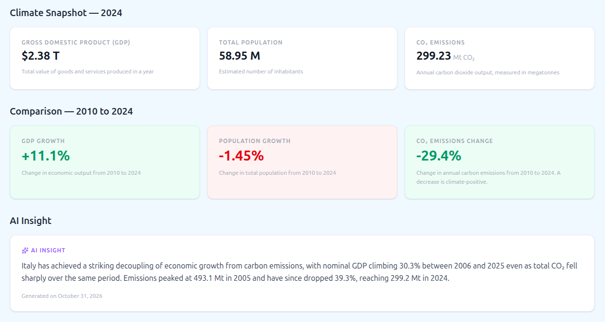
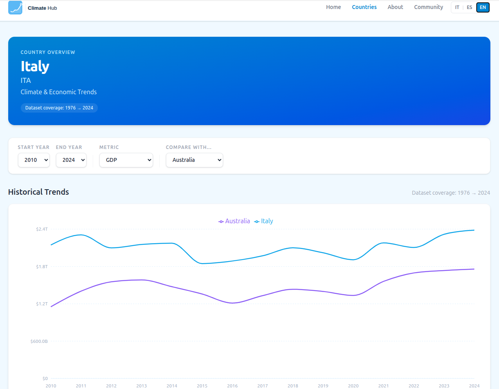
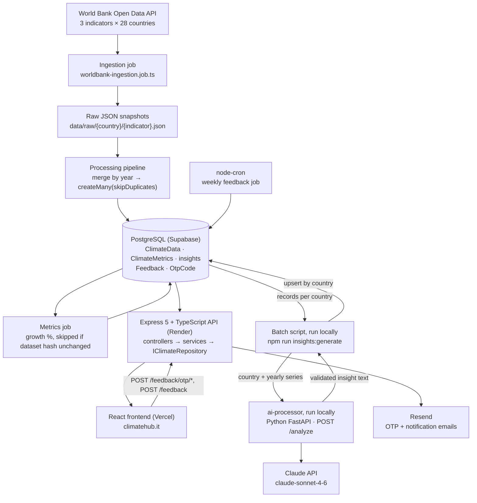

# Climate Hub

REST API that ingests World Bank GDP, population and CO₂ data for 28 countries, serves it to a web frontend, and attaches a Claude-generated insight to each country.

**Live: https://climatehub.it**




## Architecture



The deployed system is the Express API, the Supabase database and the React frontend. The Python ai-processor is not deployed: it runs on a developer machine (or in Docker Compose) only while insights are regenerated.

**Layers (backend repo):**

- `src/modules/climate/api`: Express routes, controllers, request/response DTOs, validators. Controllers only map HTTP to service calls and throw typed `AppError`s.
- `src/modules/climate/application`: services, use cases, and the `IClimateRepository` port. No Prisma imports except the generated row type.
- `src/modules/infrastructure`: Prisma client, repository implementations, World Bank HTTP client.
- `src/modules/feedback`: OTP-verified feedback form (domain schemas, OTP service, Resend client, cron job).
- `src/jobs`, `src/modules/*/pipelines`, `scripts/`: offline jobs run from the CLI (ingest, process, metrics, insights).
- `ai-processor/`: Python FastAPI service that computes the key figures, builds the prompt, calls Claude and validates the answer.

## Key design decisions

- **Insights are pre-generated, not created per visit.** `GET /api/countries/:country/insights` is a primary-key read on the `insights` table. Claude is called once per country per refresh (28 countries, up to 2 calls each), so cost is paid once per country, not once per page view, and request latency is one DB read. The web service holds no Anthropic key, and an LLM outage can't break a page load.
- **Repository port + factory injection.** `createClimateService(repo: IClimateRepository)` takes its data source as an argument. Production wires in the Prisma implementation; service tests pass a fake of `jest.fn()`s, so trend logic and edge cases (single-year countries, zero/null baselines) are tested without a database.
- **Lazy Resend client.** The email client is created on first use (`getResend()`), not at import time. Importing the feedback module, and therefore the whole app in tests, no longer requires `RESEND_API_KEY`.
- **Rerunnable ingestion.** Raw World Bank responses are written to disk and merged in a separate step, so a parsing change doesn't require re-downloading. Inserts use `skipDuplicates` on the `(country, year)` unique key. The metrics job stores an MD5 hash of each country's dataset (change detection only) and skips unchanged countries.
- **Unauthenticated feedback without spam.** Submitters verify their email with a 6-digit OTP (10-minute TTL, max 3 active codes per email), which yields an HMAC-signed token (15-minute TTL, `timingSafeEqual`) required on `POST /feedback`. Plus a honeypot field and rate limits keyed on IP + email.

## LLM output you can trust

**The bug.** A dry run of insight generation produced fluent but wrong arithmetic. For Italy the model wrote that per-capita CO₂ falling from 8.17 t to 5.08 t was "less than half"; it is 62% of the starting value. For Germany it wrote that GDP "nearly doubled"; nominal GDP went from $3.05T to $5.05T, +65.8%. Both figures were checked against the database. The model was given a table of yearly values and left to derive comparisons itself.

**The fix.** The model no longer does arithmetic:

1. **Stats computed in code** (`app/stats.py`): % change of total CO₂, per-capita CO₂ and nominal GDP over the last 20 years; peak year and value for total and per-capita CO₂, computed over the full series; change since the peak; a decoupling flag (GDP up while CO₂ down). A peak on the first available year is marked "NOT a confirmed peak".
2. **Prompt rules**: use only the numbers provided, never compute new ones, no ratio words, always say "nominal GDP". Each narrative angle (decoupling, peak, trajectory) is only allowed when the computed figures support it.
3. **Post-generation check** (`app/check.py`): every number in the answer must match a provided figure, allowing for the rounding it was written with ("39%" matches −39.2%, "$5.05 trillion" matches $5.05T). Ratio words like "half", "doubled", "twice" or "3-fold" are rejected outright, since they carry no digits.
4. **One retry**: on a mismatch the model gets its own answer back plus the list of problems as a correction hint. If the second answer still fails, `/analyze` returns `422 INSIGHT_VALIDATION_FAILED` with the problems, the failure is logged, and the batch script marks that country failed and moves on. Nothing unverified reaches the database.

```python
# ai-processor/app/check.py
def _matches(written: Number, provided: Number) -> bool:
    """True if `written` is `provided` rounded to the precision it was written with."""
    tolerance = 0.5 * 10 ** -written.decimals * written.scale
    return abs(abs(written.scaled) - abs(provided.scaled)) <= tolerance * (1 + 1e-9)


def find_problems(text: str, allowed: List[Number]) -> List[str]:
    problems = []
    for number in extract_numbers(text):
        if not any(_matches(number, provided) for provided in allowed):
            problems.append(f'"{number.text}" is not one of the provided figures')
    for match in _RATIO_WORDS.finditer(text):
        problems.append(f'"{match.group(0)}" states a ratio you computed; quote the provided percentage instead')
    return list(dict.fromkeys(problems))

# ai-processor/app/insight.py — generate_insight()
    text, problems = _complete(client, messages)
    problems += find_problems(text, allowed)

    if problems:
        if text:
            messages.append({"role": "assistant", "content": text})
        messages.append({"role": "user", "content": correction_hint(problems)})

        text, problems = _complete(client, messages)
        problems += find_problems(text, allowed)

        if problems:
            raise InsightValidationError(problems)
```

The tests use both reported sentences as fixtures: "less than half" and "nearly doubled" are rejected, and a true but computed "62%" is rejected too, because it is not a provided figure. A fake client covers the paths with no retry, a successful retry, and failure after the retry.

**Result.** A dry run on ITA, DEU and FRA passed validation, and all 28 insights were regenerated in production on 2026-10-31. Italy, before: per-capita CO₂ falling to 62% of its starting value was described as "less than half". After: "Emissions peaked at 493.1 Mt in 2005 and have since dropped 39.3%, reaching 299.2 Mt in 2024."

**What it still doesn't catch:**

- Numbers written as words ("two decades", "a third").
- A correct number attached to the wrong label, e.g. the per-capita change quoted as the change in total emissions.
- Claims that contain no numbers at all ("emissions fell sharply"). These are constrained by the prompt rules, not by the check.

## Key code: insight batch script

The script reads each country's series, sends it to the AI service, and upserts the result. `--dry-run` prints insights without writing; `--countries ITA,DEU` limits the run. One country failing doesn't stop the batch.

```ts
// scripts/generate-insights.ts
const { insight, records_analyzed } = await analyze({
  country,
  data: records.map(r => ({
    year: String(r.year),
    gdp: r.gdp,
    population: r.population,
    co2: r.co2
  }))
})

if (options.dryRun) {
  log(`${prefix} — ${records_analyzed} records analyzed\n${insight}\n`)
} else {
  await prisma.insight.upsert({
    where: { country },
    create: { country, insight, recordsAnalyzed: records_analyzed },
    update: { insight, recordsAnalyzed: records_analyzed, generatedAt: new Date() }
  })
  log(`${prefix} — done`)
}
```

## Key code: repository port and injection

```ts
// src/modules/climate/application/ports/climate-repository.port.ts
export interface IClimateRepository {
  getByCountry(country: string): Promise<ClimateData[]>
  countByCountry(country: string): Promise<number>
  getLatestValid(country: string): Promise<ClimateData | null>
  getByCountryAndYear(country: string, year: number): Promise<ClimateData | null>
  saveMany(data: ClimateData[]): Promise<void>
  getTrendBounds(country: string): Promise<{ first: ClimateData; last: ClimateData } | null>
}

// src/modules/climate/api/climate.controller.ts
const climateService = createClimateService(climateRepository)
```

## Verified

Recorded on 2026-10-31, backend at `main` after PR #2 was merged, Node 20.20.2.

| Check | Result | Command |
|---|---|---|
| Type check (strict) | 0 errors | `npx tsc --noEmit` |
| Lint | 0 problems | `npx eslint .` |
| API tests (Jest + ts-jest + Supertest) | 86 passed, 12 suites, ~4.8 s | `npm test` |
| Production build | succeeds | `npm run build` (`prisma generate && tsc && tsc-alias`) |
| ai-processor tests (stdlib unittest) | 21 passed: stats 9, check + retry 10, route logging 2 | `venv/bin/python -m unittest discover -s tests -t .` |
| Commits, backend | 91 (89 excluding merges), Mar–Oct 2026 | `git rev-list --count HEAD` |
| Commits, frontend | 42, Jun–Sep 2026 | `git rev-list --count HEAD` |
| Merged PRs, backend | 2: #1 test suite and lint, #2 insight units and number validation | `gh pr list --state merged` |
| Insights regenerated with validation | 28/28, 2026-10-31 | `npm run insights:generate` (after a `--dry-run` on ITA, DEU, FRA) |

Tests that need a database: 4 cases in `tests/unit/api/climate-data-api.test.ts` (dataset, latest, trend, specific year) run Supertest against the real app and read the database configured in `.env`. The other 82 Jest tests and all Python tests run without a database, network or API key.

| Item | Value |
|---|---|
| HTTP endpoints, API | 11: 6 under `/api`, 3 under `/feedback`, `/health`, `/` |
| HTTP endpoints, AI service | 2: `POST /analyze`, `GET /health` |
| Indicators | GDP (`NY.GDP.MKTP.CD`, current US$), population (`SP.POP.TOTL`), CO₂ (`EN.GHG.CO2.MT.CE.AR5`) |
| Countries | 28 (17 Europe, 3 North America, 3 South America, 3 Asia, 2 Oceania) |
| DB migrations | 6 |
| Frontend locales | 3 (en, it, es) |

## Tech stack and deployment

- **API:** TypeScript, Node 20, Express 5, Prisma 5, Zod, pino, helmet, express-rate-limit, node-cron, Resend, Swagger UI (`/api-docs`). Runs on Render as a web service (`npm run build`, then `node dist/src/index.js`).
- **Database:** Supabase Postgres in production. The transaction pooler serves runtime queries; the direct connection is used for `prisma migrate deploy`.
- **AI service:** Python 3.11, FastAPI, Pydantic, Anthropic SDK. Not deployed: run locally for batch insight generation.
- **Frontend (separate repo):** React 19, Vite, TanStack Query, Recharts, Tailwind CSS v4, i18next. Hosted on Vercel.
- **Local:** Docker Compose runs Postgres, the AI service and the API, with healthcheck-gated startup and migrations on boot.

## Known limitations

- Insights are generated in English only; the UI is translated into 3 languages but the insight text is not.
- The integration tests read whichever database `.env` points to; a dedicated test database in Docker is planned.
- The World Bank client doesn't paginate, so only the 50 most recent years (1976–2025) are stored; this will be fixed in ingestion, followed by a re-run.

## Code access

Source is private. Read access available on request — giu.bracale@gmail.com

---

© 2026 Giuseppe Bracale — All rights reserved.
